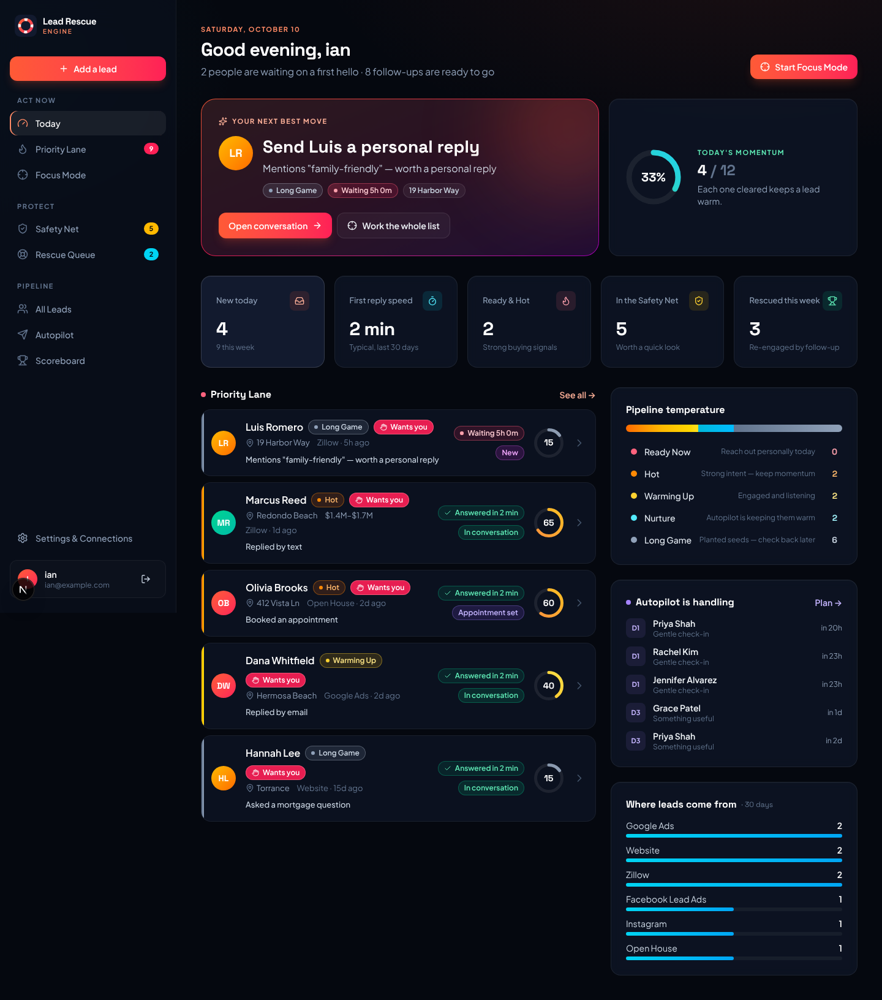

# Lead Rescue Engine

A lead recovery dashboard for real estate agents. Every lead gets a fast, personal first
hello, follow-up runs itself (Day 0 → 1 → 3 → 7 → 14 → 30), and the agent is pulled in the
moment someone is ready to talk. Nothing silently disappears — broken leads land in a
**Rescue Queue** instead of the trash.



Built with **Next.js 15**, **Auth.js** (Google + email sign-in), **Prisma + Postgres**,
and **Tailwind CSS**. Hosts on **Vercel**. Pairs with **n8n** for sending texts/emails.

---

## What's inside

| Screen | What it's for |
| --- | --- |
| **Today** | Your single "next best move", today's momentum ring, key numbers, pipeline temperature |
| **Priority Lane** | Who deserves attention right now, best first |
| **Focus Mode** | One lead at a time, big buttons, keyboard shortcuts (`Enter` send · `C` call · `T` texted · `E` emailed · `S` tomorrow · `N` next) |
| **Safety Net** | Anyone who could drift: no first hello yet, overdue follow-ups, asked for you with no reply |
| **Rescue Queue** | Leads with bad data, possible spam, or failed sends — fix and rescue in one click |
| **All Leads** | Search + filter by temperature, stage, source |
| **Lead profile** | "At a glance" answers (who, where from, interested in, reply speed, engaged?, next step), follow-up plan, timeline, score breakdown |
| **Autopilot** | The follow-up plan, what's ready to send, what's coming this week |
| **Scoreboard** | Response speed, funnel, rescued leads, source ROI |
| **Settings** | Your name in messages, quiet hours, private webhook links, n8n download, sample data |

**Temperature tiers** (same colors everywhere): Ready Now (80+) · Hot (60–79) · Warming Up (40–59) · Nurture (20–39) · Long Game (0–19).

---

## Deploy to Vercel (about 20 minutes)

### 1. Import the repo
1. Go to [vercel.com/new](https://vercel.com/new) and import this GitHub repository.
2. Don't deploy yet — first add a database and keys.

### 2. Add a database
1. In your Vercel project: **Storage → Create Database → Neon (Postgres)** → connect it to the project.
2. This adds `DATABASE_URL` (and usually `DATABASE_URL_UNPOOLED`) for you. Only `DATABASE_URL`
   is required — if your database's variable has a different name, copy its value into
   a variable called `DATABASE_URL`.

The tables are created automatically on every deploy (`vercel-build` runs `prisma db push`).

### 3. Sign-in secret
Add an environment variable `AUTH_SECRET`. Generate a value with `openssl rand -base64 32`
(or any long random string).

### 4. Email + password sign-in (works right away)
Nothing to configure — open the site, click **Create an account**, and sign up with your
email and a password (8+ characters). Passwords are stored as one-way scrambled hashes,
never as the real text. Use `ALLOWED_EMAILS` (step 6) so only your people can create accounts.

### 4b. Google sign-in (optional, recommended)
1. [Google Cloud Console → APIs & Services → Credentials](https://console.cloud.google.com/apis/credentials)
   → **Create credentials → OAuth client ID** → *Web application*.
2. **Authorized redirect URI:** `https://YOUR-APP.vercel.app/api/auth/callback/google`
3. Add `AUTH_GOOGLE_ID` and `AUTH_GOOGLE_SECRET` in Vercel.

### 5. "Forgot password" email links (optional)
Without this, someone who forgets their password can still sign in with Google (same email)
and set a new one in **Settings**. To also offer "email me a sign-in link":
1. Create a free [Resend](https://resend.com) account, verify your domain, and create an API key.
2. Add `AUTH_RESEND_KEY` and `EMAIL_FROM` (e.g. `Lead Rescue <login@yourdomain.com>`).

### 6. Lock it down (recommended)
Set `ALLOWED_EMAILS` to a comma-separated list of who may sign in, e.g.
`ian@hisbrokerage.com,ian.personal@gmail.com`. Leave blank to allow anyone.

### 7. Daily housekeeping (optional)
Add `CRON_SECRET` (any random string). Vercel Cron calls `/api/cron` once a day
(see `vercel.json`) to apply the "quiet 30 days" score and move finished sequences to Long Game.

### 8. Deploy
Click **Deploy**. Sign in, then on the **Today** screen click **Load sample leads** to explore.

---

## Connect n8n

1. In the app: **Settings → Connections → Download n8n workflow**. It already contains your
   private links.
2. In n8n: **Workflows → Import from File**.
3. Add your **Twilio** credentials (and replace `+1YOURTWILIONUMBER`) and **Gmail** credentials.
4. Point your lead sources (Facebook Lead Ads, Zillow emails, website forms…) at the
   workflow's **New lead (webhook)** node — or straight at your intake link.

The workflow:
- **New lead (webhook) → Send to Lead Rescue** — forwards leads into the app.
- **Every 5 minutes → Get due messages → Text or email? → Twilio / Gmail → Report sent / failed** —
  the app decides *what* is safe to send (quiet hours, consent, opt-outs, paused leads); n8n just delivers.

Until n8n is connected, Autopilot runs in **tap-to-send mode**: due messages show a *Send*
button that opens your phone's texting/email app with the message filled in.

### API reference

All URLs include your private token (Settings → Connections).

| Endpoint | Purpose |
| --- | --- |
| `POST /api/intake/{token}` | New lead. JSON or form data; field names are flexible (`first_name`, `firstName`, `name`, `phone_number`, Facebook `field_data`, …). Returns `outcome: created \| merged \| queued`. |
| `POST /api/events/{token}` | Engagement: `{ "type": "reply_text", "phone" \| "email" \| "leadId": "...", "note": "..." }`. Types: `reply_text, reply_email, showing_request, calendar_booked, mortgage_question, valuation_request, seller_inquiry, website_visit, viewed_properties, link_click, unsubscribe, sms_stop, invalid_phone`. Strong events pause autopilot, flag the lead, and return an `alert` sentence to forward to you. |
| `GET /api/outbox/{token}` | Messages due now and safe to send. |
| `POST /api/outbox/{token}` | `{ "touchId": "...", "status": "sent" \| "failed", "error": "..." }` |

---

## Run it on your computer

```bash
npm install
cp .env.example .env      # fill in DATABASE_URL etc.
echo 'DEV_LOGIN="true"' >> .env   # password-free login for local testing only
npx prisma db push        # create tables
npm run dev               # http://localhost:3000
```

`DEV_LOGIN` never works in production.

---

## How it's organized

```
prisma/schema.prisma        Database tables (leads, follow-up steps, timeline, rescue queue)
src/auth.ts                 Sign-in providers
src/lib/normalize.ts        Turns any lead format into one clean shape
src/lib/intake.ts           The intake pipeline: validate → dedupe → score → build plan
src/lib/scoring.ts          0–100 lead score from explainable signals
src/lib/messages.ts         Follow-up templates + Fair Housing review flag
src/lib/engagement.ts       Replies/events, logging contact, completing steps
src/lib/queries.ts          Priority Lane, Safety Net, dashboard numbers
src/app/(app)/…             The screens
src/app/api/…               Webhooks for n8n
src/app/actions.ts          Button/form handlers (Server Actions)
```

### Guardrails built in
- Message templates never claim availability, price changes, offers, or seller details —
  if a lead asks "is it still available?", the reply says the agent will confirm.
- Inquiries mentioning schools, "safe area", religion, etc. are held for a personal reply
  (Fair Housing) instead of automated messaging.
- Quiet hours, SMS consent, unsubscribes, STOP, and do-not-contact are enforced server-side.
- Every change is written to the lead's timeline (audit log).
